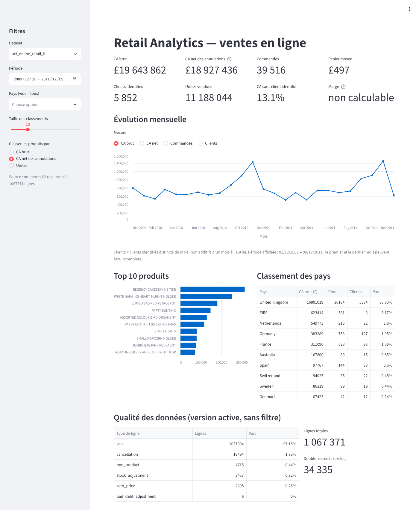

# retail-analytics-pipeline

[](../../actions/workflows/ci.yml)

Pipeline de données de bout en bout sur des ventes e-commerce réelles (1,07 M de lignes) : **lecture →
validation → nettoyage Pandas → PostgreSQL (raw / staging / marts) → KPI SQL → dashboard Streamlit**, avec tests
unitaires, d'intégration et du dashboard.



*Capture du dashboard sur les données réelles (vue par défaut, produits classés au CA net des annulations).*

> **Statut des données.** Les résultats de [docs/analysis_uci.md](docs/analysis_uci.md) et
> [docs/findings.md](docs/findings.md) portent sur le **vrai dataset Online Retail II** (1 067 371 lignes).
> Un **échantillon synthétique** clairement étiqueté (`data/sample/`) sert aux tests et à une démo hors ligne ;
> ses chiffres ([docs/analysis_sample.md](docs/analysis_sample.md)) ne décrivent aucune entreprise réelle.

**Résultats clés (données réelles, 01/12/2009 → 09/12/2011)** — CA brut £19,64 M, CA net des annulations
£18,93 M, 39 516 commandes, 5 852 clients identifiés (72 % ont commandé au moins deux fois), Royaume-Uni = 85,5 %
du CA, top 20 % des produits = 78 % du CA. Deux commandes géantes annulées en totalité (£245 653) faussent
le classement au CA brut : d'où le classement au CA net. Détails : [docs/findings.md](docs/findings.md).

## Dataset

| | |
|---|---|
| Nom | Online Retail II — UCI Machine Learning Repository |
| Page | https://archive.ics.uci.edu/dataset/502/online+retail+ii |
| DOI | [10.24432/C5CG6D](https://doi.org/10.24432/C5CG6D) |
| Créateur | Daqing Chen |
| Licence | CC BY 4.0 (réutilisation libre avec attribution) |
| Contenu | ~1,07 M lignes de factures d'un e-commerçant britannique, 01/12/2009 → 09/12/2011, prix en GBP |
| Format | `online_retail_II.xlsx` (2 feuilles) dans une archive ZIP |
| Repli utilisé ici | copie redistribuée par le package R [`onlineretail2`](https://github.com/allanvc/onlineretail2) (« avec la permission du donateur », usage non commercial), épinglée par commit et SHA-256 |

Colonnes : `Invoice` (préfixe `C` = annulation), `StockCode`, `Description`, `Quantity`, `InvoiceDate`,
`Price`, `Customer ID`, `Country`. Aucun coût d'achat : **la marge n'est pas calculable** et n'est pas inventée.

**Accès à la source.** Le pipeline essaie d'abord le ZIP officiel UCI. Si UCI est injoignable,
`fetch-uci --mirror` télécharge le fichier `.rda` du package R au commit `35b2729` et **refuse tout fichier
dont le SHA-256 diffère**. Contrôles sur cette copie (`tests/test_real_data.py`) : 1 067 371 lignes, comme
annoncé par UCI, et même période. Le fichier officiel `.xlsx`, s'il est présent dans `data/raw/`, est
toujours prioritaire.

## Architecture

```
sources.py   téléchargement UCI (ou miroir épinglé, SHA-256 vérifié)
   ▼
fichier .xlsx / .csv / .rda
   │ extract.py      lecture en texte + provenance (fichier, feuille, ligne, SHA-256)
   ▼
validate.py ── schéma invalide / > 5 % de lignes illisibles ──► arrêt, base intacte
   │ transform.py    typage, normalisation, classification line_type, doublons (rien n'est supprimé)
   │ validate.py     rapport qualité → data/reports/<dataset>_quality.json
   ▼ load.py (1 transaction, COPY + upsert)
PostgreSQL
   raw.sales_lines        copie fidèle en texte          clé = (dataset, sha256, feuille, ligne)
   staging.sales_lines    typé + indicateurs qualité     même clé, FK vers raw
   meta.load_runs         journal des exécutions + rapport qualité JSONB
   meta.dataset_current   version active de chaque dataset
   marts.*                vues analytiques (sql/02_marts.sql), reconstruites à chaque run
   ▼
kpis.py (requêtes paramétrées)  ──►  dashboard/app.py (Streamlit)
```

Le brut est conservé tel quel en base (`raw`), comme dans un ELT ; le typage et la classification des lignes
sont faits en Pandas avant l'écriture de `staging`, et les agrégats en SQL. C'est donc un pipeline hybride,
choisi pour tester le nettoyage sans base. Détails et justification des choix :
[docs/architecture.md](docs/architecture.md) ; revue avant publication : [docs/review.md](docs/review.md).

## Arborescence

```
retail-analytics-pipeline/
├── README.md  LICENSE  pyproject.toml  requirements.txt  constraints.txt  .env.example  .gitignore
├── docker-compose.yml  .streamlit/config.toml  .github/workflows/ci.yml
├── docker/init-test-db.sql          crée la base retail_test au 1er démarrage du conteneur
├── src/retail_analytics/
│   ├── config.py      variables d'environnement, chemins, source UCI
│   ├── sources.py     téléchargement de la source (UCI, miroir épinglé)
│   ├── extract.py     lecture CSV/XLSX, normalisation des noms de colonnes
│   ├── validate.py    validation du schéma + rapport qualité
│   ├── transform.py   nettoyage Pandas, classification, doublons
│   ├── load.py        chargement idempotent PostgreSQL
│   ├── db.py          moteur SQLAlchemy, scripts SQL, COPY
│   ├── kpis.py        KPI SQL filtrables + référence Pandas
│   ├── sample_data.py générateur de l'échantillon synthétique
│   ├── pipeline.py    orchestration
│   ├── report.py      rapport d'analyse Markdown généré depuis les marts
│   └── cli.py         ligne de commande
├── sql/01_schema.sql  sql/02_marts.sql
├── dashboard/app.py
├── data/sample/       échantillon synthétique versionné (+ README)
├── data/raw/ processed/ reports/   non versionnés
├── tests/             unitaires + intégration (PostgreSQL, dashboard)
└── docs/              architecture, qualité, KPI, analyses (réelle + synthétique), constats, entretien
```

## Démarrage rapide

Prérequis : Python 3.12 (3.11+), PostgreSQL 16 (local ou Docker), **4 Go de RAM libres** pour le dataset réel
(pic mesuré : 2,1 Go pendant le chargement). Guide pas à pas pour Windows :
[docs/local_setup_windows.md](docs/local_setup_windows.md).

```bash
python3.12 -m venv .venv && source .venv/bin/activate        # Windows : .venv\Scripts\activate
pip install -r requirements.txt -c constraints.txt            # versions exactes testées (transitives incluses)
pip install -e .
cp .env.example .env                                           # puis remplacer change_me

# PostgreSQL : soit Docker…
docker compose up -d && docker compose ps                      # attendre "healthy"
# …soit un PostgreSQL existant : créer les bases retail et retail_test, adapter .env

python -m retail_analytics.cli check-db                       # teste la connexion
python -m retail_analytics.cli run --source sample --dry-run  # sans base : validation + rapport qualité
python -m retail_analytics.cli run --source sample            # pipeline complet
streamlit run dashboard/app.py                                 # http://localhost:8501
pytest                                                         # tous les tests
```

**Windows (PowerShell)** : `py -3.12 -m venv .venv`, `.venv\Scripts\Activate.ps1`, `copy .env.example .env` ;
les variables d'environnement se posent avec `$env:RUN_REAL_DATA="1"; pytest tests/test_real_data.py`.

### Codes de sortie et erreurs

| Code | Signification | Exemple de message |
|---|---|---|
| 0 | succès | — |
| 2 | configuration, réseau ou base | `Connexion PostgreSQL impossible : connection timeout expired` |
| 3 | données refusées (rien n'est chargé) | `Données refusées, rien n'a été chargé : colonnes manquantes : […]` |

Les erreurs attendues produisent une ligne lisible, jamais une trace Python. La connexion est abandonnée après
`DB_CONNECT_TIMEOUT` secondes (10 par défaut). Les chargements simultanés sont sérialisés par un verrou
PostgreSQL, et un run interrompu (processus tué) est marqué `failed` au chargement suivant.

Dates « a/b/AAAA » (copies CSV) : l'ordre jour/mois est **déduit de tout le fichier**. S'il est indéterminable
(jour et mois ≤ 12 partout), l'ordre US est supposé et un avertissement s'affiche ; `--date-order dmy|mdy` le
force. Des ordres mélangés dans un même fichier ne sont jamais devinés.

`generate-sample` régénère l'échantillon à l'identique (graine 42) ; un test vérifie que le fichier versionné
correspond bien au générateur.

### Charger le vrai dataset

```bash
python -m retail_analytics.cli fetch-uci            # source officielle UCI -> data/raw/online_retail_II.xlsx
python -m retail_analytics.cli fetch-uci --mirror   # idem, avec repli sur la copie R épinglée si UCI échoue
# ou téléchargement manuel depuis la page UCI, puis : placer online_retail_II.xlsx dans data/raw/
python -m retail_analytics.cli run --source uci -v  # ~110 s depuis le .rda, ~130 s depuis le .xlsx
python -m retail_analytics.cli report --output docs/analysis_uci.md   # rapport régénéré depuis les marts
RUN_REAL_DATA=1 pytest tests/test_real_data.py      # contrôles sur le vrai fichier
```

Les deux datasets coexistent en base ; le dashboard propose un sélecteur et affiche un bandeau
« données synthétiques » sur l'échantillon.

## Règles de qualité (résumé)

Aucune ligne n'est supprimée : chaque ligne reçoit un `line_type` et des indicateurs, et les KPI filtrent
explicitement sur `is_valid_sale`.

| line_type | Règle (par priorité) |
|---|---|
| `invalid` | facture, code, quantité, date ou prix manquant/illisible ; quantité non entière |
| `bad_debt_adjustment` | facture commençant par `A` |
| `cancellation` | facture commençant par `C` (annulations/retours) |
| `non_product` | `POST`, `DOT`, `M`, `BANK CHARGES`, `AMAZONFEE`, `ADJUST*`, `TEST*`, `gift_*`… |
| `stock_adjustment` | quantité ≤ 0 hors annulation (casse, perte) |
| `zero_price` | prix ≤ 0 |
| `sale` | le reste |

`is_duplicate` marque les doublons exacts (toutes colonnes métier identiques) après la 1re occurrence.
`is_valid_sale = line_type = 'sale' AND NOT is_duplicate`. Détails : [docs/data_quality.md](docs/data_quality.md),
définitions des KPI : [docs/kpi_definitions.md](docs/kpi_definitions.md).

## Rechargements et reproductibilité

- Même fichier rechargé → 0 nouvelle ligne brute, staging mis à jour, KPI identiques (testé).
- Nouvelle version du fichier → elle devient la version active ; l'ancienne reste dans `raw` pour l'audit,
  mais n'est plus comptée (testé).
- Échec en cours de chargement → transaction annulée, exécution marquée `failed` dans `meta.load_runs` (testé).
- Échantillon déterministe (graine), dépendances directes dans `requirements.txt`, versions exactes de
  toutes les dépendances dans `constraints.txt`.
- Schéma versionné (`meta.schema_info`) : une base créée par une version incompatible est refusée avec un
  message clair, avant toute écriture.

## Résultats vérifiés (2026-10-20, Python 3.12, PostgreSQL 16.15)

- `REQUIRE_DB=1 pytest` : **101 passed, 3 skipped**, couverture 91 % (unitaires + intégration PostgreSQL +
  dashboard via `streamlit.testing`). Les 3 tests ignorés portent sur les données réelles et ne s'exécutent que
  sur demande : `RUN_REAL_DATA=1` → **3 passed**.
- Sans base de test, les tests d'intégration sont **ignorés** (`skipped`) ; en CI, `REQUIRE_DB=1` les fait
  **échouer** pour qu'une base absente ne passe jamais pour une suite verte.
- Audit qualité et fiabilité (20 défauts trouvés et corrigés) : [docs/qa_report.md](docs/qa_report.md).
- Données réelles : 1 067 371 lignes chargées en ~90 s, 1 003 340 ventes valides (94,0 %), 0 ligne illisible.
  Rechargement : 0 nouvelle ligne brute.
- Cohérence : la somme du CA et des annulations de chaque mart égale le total de `kpi_summary` à 0,00 £ près.
- Dashboard exécuté sur les données réelles : KPI identiques aux marts, filtres et état vide vérifiés.
- Installation neuve avec `constraints.txt` : environnement identique à celui testé ; étapes du workflow CI
  rejouées à l'identique (sans `.env`) → tous les tests passent. Le workflow n'a pas encore tourné sur GitHub.
- Chemin officiel `.xlsx` vérifié à l'échelle : fichier de 1 067 371 lignes au format UCI (2 feuilles),
  reconstruit à partir du miroir → mêmes chiffres exactement que depuis le `.rda`.

## Limites

- Le fichier officiel UCI (.xlsx) n'a pas pu être téléchargé ici (refus du proxy) : les résultats réels
  viennent de la copie R épinglée. Le chemin `.xlsx` a été vérifié sur une reconstruction au même format,
  pas sur le fichier téléchargé chez UCI. Relancer `fetch-uci` chez soi pour charger la source officielle.
- Dashboard : ~6 s pour le premier affichage sur 1 M de lignes (requêtes `COUNT(DISTINCT)`), puis instantané
  grâce au cache ; chaque nouvelle combinaison de filtres coûte de 0,5 à 6 s.
- `docker-compose.yml` validé (`docker compose config`), mais le conteneur n'a pas été démarré : le registre
  d'images Docker était inaccessible depuis l'environnement de développement.
- Les annulations ne sont pas rattachées à la facture d'origine (pas de lien dans les données) ; certaines
  peuvent concerner des ventes antérieures à la période couverte.
- Pas de distinction annulation / retour possible : le dataset ne la fournit pas.
- Un même `StockCode` peut avoir plusieurs libellés (596 codes sur données réelles) : le plus fréquent est retenu.
- Pays : certains (EIRE) reposent sur 2 ou 3 comptes grossistes ; un classement par pays y mesure des clients, pas un marché.
- Pas d'orchestrateur (Airflow) ni de dbt : non justifiés pour un fichier statique chargé à la demande
  (voir [docs/architecture.md](docs/architecture.md) pour quand les ajouter).

## Licence et attribution

Code sous licence MIT. Données : Chen, D. (2012). *Online Retail II* [Dataset]. UCI Machine Learning
Repository. https://doi.org/10.24432/C5CG6D — CC BY 4.0.
